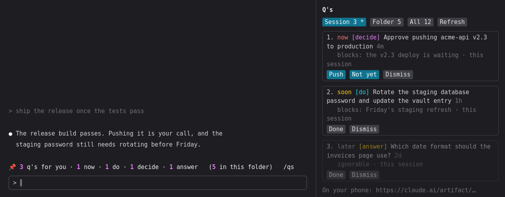

# Todo Nag List

Claude keeps asking you to do things and then scrolls them out of sight; this keeps them in one list, pinned above your prompt.



*Sample data. Left: the line above the prompt. Right: the `/qs` pane.*

## Quickstart

1. In a Claude Code terminal session, run:
   ```
   /plugin install qs --marketplace matthandlersux/claude-todo-naglist
   ```
   Answer `y` to add the marketplace, then pick a scope.
2. When Claude first asks to use `ArtifactData`, choose **always allow** (details below).
3. Work as usual. Whenever Claude leaves you something to do, decide or answer, a 📌 line appears above the prompt.
4. Type `/qs` to open the list, then press **Done**, **Dismiss** or a reply button.

## What it does

A Claude Code mod (plugin name `qs`). Every to-do, decision or question a session leaves you (a "q")
goes into one list on your claude.ai account, with the count kept in sight.

- **Captured as Claude writes.** Claude gets three tools (`qs_add`, `qs_resolve`, `qs_list`) and a
  system-prompt note telling it to file each to-do, decision or question for you, one per item, and to
  close items when you say you did them or answer them.
- **Every ask is judged.** Claude must guess two things when it files one: **urgency** (time: `now` = today
  or something waits on it, `soon` = this week, `later` = no clock) and **ignorable** (true only if nothing
  real is tied to it, blocked on it or half done), plus what it blocks.
- **Re-ranked as things change.** A triage pass (sonnet) re-judges every open ask across all your sessions
  and folders and puts them in order: every 6 hours, or 20 minutes after the last pass when new asks are
  waiting. New asks sort to the top of their urgency until a pass places them. Only one session runs a pass
  at a time (a claim doc in collection `asksMeta`). `/qs triage` runs one now.
- **Reply buttons.** When your part is just clicking (approve a push, pick A or B), Claude files the q with
  2-3 buttons, e.g. **Push** / **Not yet**. Click one in the pane or on your phone: the q closes with that
  answer and the session that filed it gets it as your reply and carries on. From the phone it arrives within
  a minute (each session checks once a minute); a closed session gets it when you resume it.
- **Safety net.** After each longer reply a cheap model call (haiku) checks for q's Claude forgot to file
  and adds them (marked `sweep`). It never holds up the turn. Can be switched off.
- **Always visible.** A line above the prompt: `📌 3 q's for you · 1 do · 1 decide · 1 answer   (7 in this folder)   /qs`.
  Nothing shows when there are none.
- **A pane** (`/qs`): Session / Folder / All tabs, in priority order (urgency, then not-ignorable, then the
  last triage's rank), with Done and Dismiss buttons.
- **Your phone.** The list lives in the database of a private claude.ai page:
  https://claude.ai/artifact/HNv6tEtKy3rXX2QzkVqRHs. Open it anywhere you're signed in to Claude, tick things off there.
  Priority order by default, or grouped by folder.

## Install

At the prompt of a terminal session: `/plugin install qs --marketplace matthandlersux/claude-todo-naglist`.
From a shell: `claude plugin install qs --marketplace matthandlersux/claude-todo-naglist`.

To stop using it: `/plugin uninstall qs` (your list stays on the claude.ai page).

## Allow ArtifactData

The mod reads and writes the list through Claude Code's built-in `ArtifactData` tool, which goes through
the normal permission check. The first time, you'll be asked: choose to always allow `ArtifactData`
(or add `"ArtifactData"` to `permissions.allow` in `~/.claude/settings.json`). Otherwise you'll be asked on every refresh.

## Commands

| Command | What it does |
|---|---|
| `/qs` | Open the pane |
| `/qs done <n>` | Mark this session's item number `n` done (numbers as the pane shows them, in priority order) |
| `/qs dismiss <n>` | Dismiss item `n` |
| `/qs triage` | Re-rank every open ask now |
| `/qs off` | Stop capturing in this session: no prompt note, no sweep, no band; the tools answer that capture is off |
| `/qs on` | Turn it back on (on is the default) |

## Options (`/config`, or `pluginConfigs` in settings)

| Option | Default | Meaning |
|---|---|---|
| `artifactUrl` | the page above | The claude.ai page whose database (collection `asks`) holds the list |
| `sweep` | `true` | The after-reply safety-net check |

## How it stores things

One document per q in the page's `asks` collection (the name predates the rename): `text`, `kind` (do/decide/answer), `status`
(open/done/dismissed), `folder` (the git root, else the working directory), `folderName`, `sessionId`,
`sessionName` (the session's title when Claude Code reports one), `sessionStarted`, `createdAt`,
`closedAt`, `closedBy` (session/pane/page), `source` (tool/sweep), `urgency` (now/soon/later),
`ignorable`, `blocks`, `options` (reply buttons), `answer`, `answeredAt`, `deliveredAt`, `rank` (the last triage's position, null until triaged), `triagedAt`.
Collection `asksMeta`, doc `triage`: `lastRun`, `runningUntil` (the claim). The database is the truth; the
session keeps a cache of the open ones, refreshed when the pane opens, after each write, at the start
and end of every turn, and every minute while the pane is open.

## Developing

`claude plugin validate .` and `claude plugin test .` (tests in `tests/`).
